<div align="center">

# Movements API

**El backend de Movements: finanzas personales y compartidas, en tiempo real.**
Registrá movimientos, servicios, ingresos, presupuestos y metas de ahorro, solo o en un workspace con tu familia.




</div>

---

## Qué hace

| Área | Para qué sirve |
| --- | --- |
| **Movimientos** | Débitos, créditos, ingresos y reintegros con categorías, cuotas, bancos y varias monedas. |
| **Importar extractos** | Subí el PDF de Santander (cuenta o tarjeta) y la API detecta los movimientos y avisa cuáles ya estaban cargados. |
| **Servicios e ingresos** | Pagos recurrentes con seguimiento de pago e ingresos fijos que se cargan solos cada mes. |
| **Presupuestos** | Un monto por categoría y moneda (mensual, anual o único) con alertas al cruzar el umbral. |
| **Cierre de mes** | Resumen del mes anterior (gastado, ahorrado, categoría top, aporte de cada miembro), disponible en `/v1/users/me`. |
| **Metas, rachas e insights** | Metas de ahorro, insignias por cumplir presupuestos y proyecciones. |
| **Workspaces** | Compartí datos con otras personas con roles `OWNER`, `COLLABORATOR` y `READ_ONLY`. |
| **Tiempo real** | Todo cambio se publica por WebSocket (STOMP/SockJS) a los demás miembros del workspace. |

Usuarios, workspaces e invitaciones viven en [api-identity](https://github.com/matiasferrerovilas/api-identity); esta API solo guarda los datos financieros.

---

## Tutorial: levantarlo en tu máquina

### Requisitos

- **Java 25** (JDK) y Gradle (se usa el wrapper `./gradlew`).
- **Docker**, para MySQL, RabbitMQ y Redis.
- [api-identity](https://github.com/matiasferrerovilas/api-identity) corriendo en `http://localhost:8082` (o definí `IDENTITY_API_URL`).
- Un Keycloak accesible (variable `KC_URL_REALM`, el issuer de los JWT).

### Pasos

```bash
# 1. Clonar
git clone https://github.com/matiasferrerovilas/api-movements.git
cd api-movements

# 2. Levantar las dependencias (MySQL, RabbitMQ, Redis/Valkey)
docker-compose -f docker-compose/docker-compose.yml up -d mysql rabbitmq redis

# 3. Correr la API con el perfil dev
./gradlew bootRun --args='--spring.profiles.active=dev'
```

Si necesitás credenciales propias, creá `src/main/resources/application-dev.yml` con tu `spring.datasource`. La API queda en <http://localhost:8081> y Liquibase crea el schema solo.

### Probala con datos de ejemplo

El perfil `demo` carga unos meses de movimientos, presupuestos, una suscripción, ingresos y metas:

```bash
./gradlew bootRun --args='--spring.profiles.active=demo'
```

- Solo corre con el perfil `demo` y es idempotente: reiniciar no duplica datos.
- Asume que existe el workspace `1` (el perfil `demo` de api-identity lo crea).

### Documentación interactiva

Con la API corriendo (fuera de producción):

- Swagger UI: <http://localhost:8081/swagger-ui.html>
- OpenAPI JSON: <http://localhost:8081/v3/api-docs>

### Autenticación

Pedí un token a tu realm de Keycloak y mandalo en cada request:

```
Authorization: Bearer <token>
```

---

## Tutorial: probar un endpoint

```bash
# Tu usuario y workspaces
curl -H "Authorization: Bearer $TOKEN" http://localhost:8081/v1/users/me

# Movimientos del workspace (paginado, con filtros)
curl -H "Authorization: Bearer $TOKEN" "http://localhost:8081/v1/expenses?type=GASTO&size=20"

# Importar el PDF de un banco
curl -H "Authorization: Bearer $TOKEN" -F "file=@extracto.pdf" http://localhost:8081/v1/expenses/import-file
```

La lista completa de endpoints está en Swagger.

---

## Scripts útiles

| Comando | Qué hace |
| --- | --- |
| `./gradlew bootRun --args='--spring.profiles.active=dev'` | Levanta la API en desarrollo. |
| `./gradlew test` | Corre los tests (Spock + Testcontainers). |
| `./gradlew checkstyleMain checkstyleTest` | Corre checkstyle. |
| `./gradlew test checkstyleMain checkstyleTest` | Las dos cosas; es lo que se espera antes de dar un cambio por terminado. |
| `docker build -t movements-api .` | Construye la imagen nativa con GraalVM. |

---

## Cómo está armado

El diagrama de arriba resume el flujo: cada request pasa por Spring Security (JWT de Keycloak), los controllers y los servicios de dominio, que escriben en MySQL. Los eventos se publican por WebSocket **recién después del commit**, y las invitaciones llegan por RabbitMQ desde api-identity.

- **Stack:** Java 25 · Spring Boot 4.1 · Spring Data JPA · Liquibase · MapStruct · Spring AOP · Redis (caché y rate limit) · RabbitMQ · Micrometer/Prometheus · Spock + Testcontainers.
- **Servicios separados por responsabilidad:** `*AddService` escribe, `*QueryService` lee, `*Factory` construye entidades.
- **Membresía:** los métodos que modifican recursos de un workspace llevan `@RequiresMembership`.
- **Base de datos:** el schema lo maneja Liquibase (`ddl-auto: none`), con migraciones en `src/main/resources/db/changelog/`.
- **Tareas programadas:** ingresos recurrentes, cuotas de crédito, servicios vencidos e insignias de presupuesto.

```
src/main/java/api/m2/movements/
├── controller/     # REST, un controller por dominio bajo /v1/*
├── services/       # Lógica de negocio por dominio + publishers WebSocket
├── clients/        # api-identity y Frankfurter (HttpExchange)
├── entities/       # Entidades JPA
├── repositories/   # Spring Data
├── aspect/         # Guard de membresía
├── security/       # Resource server JWT
└── configuration/  # WebSocket, Redis, RabbitMQ, CORS
```

## Despliegue

La CI construye una imagen nativa **arm64** y la publica en Docker Hub. En producción hacen falta, entre otras, `DB_URL`, `DB_USERNAME`, `DB_PASSWORD`, `RABBIT_URL`, `REDIS_URL`, `KC_URL_REALM`, `IDENTITY_API_URL` y `CORS_ALLOWED_ORIGINS` (Swagger queda deshabilitado). Las métricas están en `/actuator/prometheus`.

## Contribuir

- Todo cambio de código lleva su test (Spock, sin `@SpringBootTest`) y pasa `checkstyle`.
- Commits con [Conventional Commits](https://www.conventionalcommits.org/es/v1.0.0/) (`feat:`, `fix:`, `docs:`...).
- Cada cambio se anota en el [CHANGELOG](CHANGELOG.md).
- Más detalle de convenciones en [CLAUDE.md](CLAUDE.md).

## Licencia

MIT — ver [LICENSE](LICENSE).
